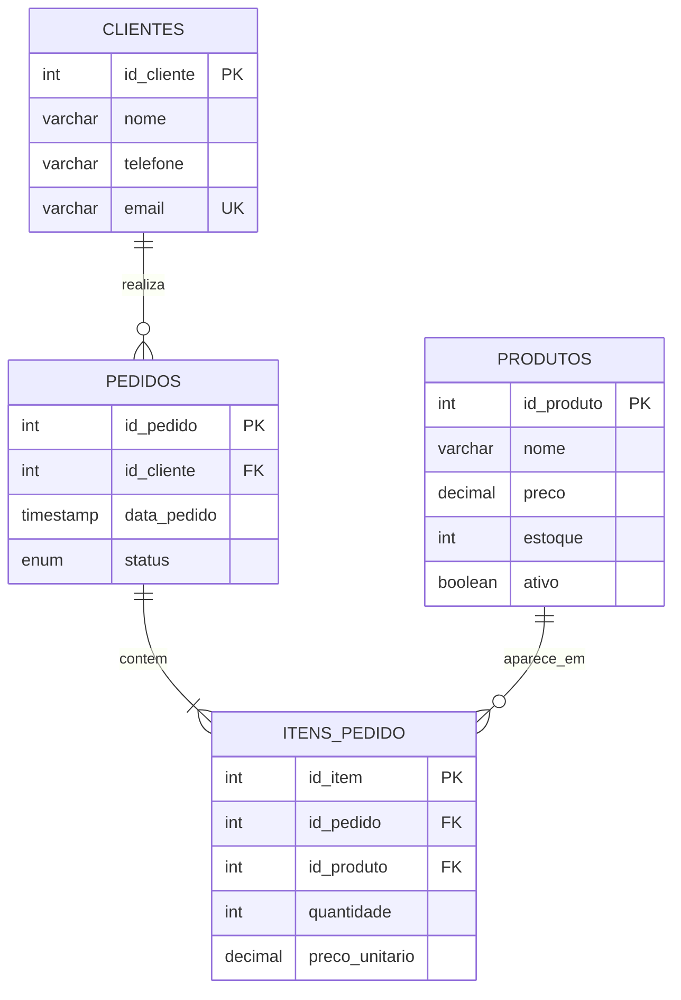

# Modelo relacional

## Restrições e decisões
- Chaves primárias identificam cada registro.
- `pedidos.id_cliente` referencia `clientes.id_cliente`.
- `itens_pedido.id_pedido` referencia `pedidos.id_pedido`; excluir um pedido exclui seus itens (`ON DELETE CASCADE`).
- `itens_pedido.id_produto` referencia `produtos.id_produto`; produtos referenciados não podem ser excluídos fisicamente (`ON DELETE RESTRICT`).
- `clientes.email` é único quando informado.
- Preços não podem ser negativos; estoque não pode ser negativo; quantidade do item deve ser maior que zero.
- `preco_unitario` é copiado para o item do pedido para preservar o valor histórico, mesmo que o preço atual do produto mude.
- A remoção lógica (`ativo = FALSE`) preserva o histórico do catálogo.
